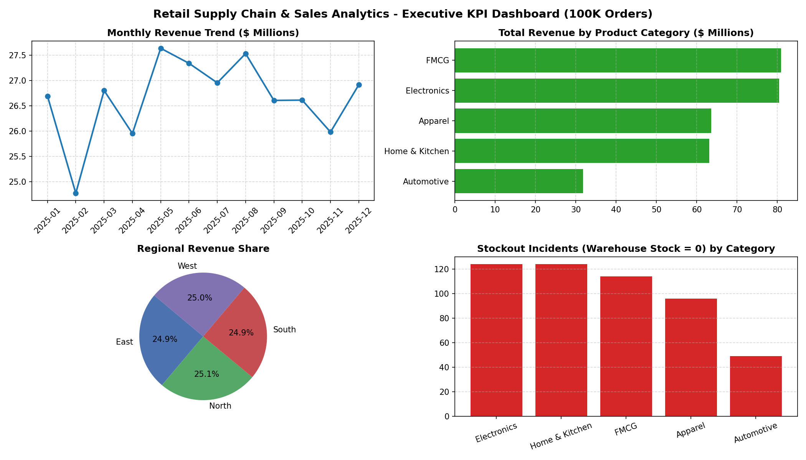

# Retail Supply Chain & Sales SQL Analytics

An end-to-end **SQL & Python Data Analytics** project designed to analyze 100,000+ retail supply chain orders, reconcile cross-table order discrepancies, compute Month-over-Month (MoM) revenue growth, and monitor SKU-level stockout risks.

## Architecture & Key Features
1. **Relational Star Schema (schema_and_analytics.sql)**:
   - Structured around a central act_orders table linked to dim_products and dim_customers dimension tables, alongside an erp_invoice_log staging table.
   - Optimized with composite and B-Tree indexes (idx_orders_date, idx_orders_product, idx_customers_region) for fast analytical aggregations.
2. **Advanced SQL Analytics**:
   - **Data Reconciliation**: Uses LEFT JOIN to detect missing order_id + product_id combinations between transactional orders and ERP invoice logs.
   - **Time-Series KPIs**: Uses **Common Table Expressions (CTEs)** and LAG() window functions to calculate Month-over-Month (MoM) revenue growth.
   - **SKU Profitability Ranking**: Uses RANK() OVER (PARTITION BY category ...) to identify top revenue-generating SKUs per category.
   - **Inventory Risk Classification**: Uses conditional CASE aggregations to flag high-risk stockout SKUs.
3. **Python ETL & Memory Optimization (etl_and_eda.py)**:
   - Cleans raw transactional logs, deduplicates composite keys, downcasts numeric/categorical columns in Pandas (reducing RAM usage by ~50%+), and exports monthly KPI summaries for **Power BI / Excel** visualization.

## Executive KPI Dashboard Preview

